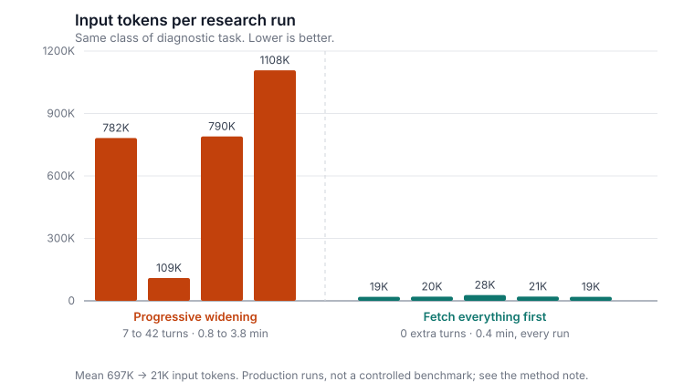

# More data, fewer tokens

*What happened when I stopped letting a research agent decide how much data it needed.*

I made my research agent fetch more data than before. It got about 33 times cheaper and six times faster.

That is not a typo, and the explanation is the useful part.

## The pattern I started with

Start small and grow. The textbook example is a date window: pull the last 30 days, and if the sample is too thin, widen to 60, then 90. It is one of the oldest shapes in data work, and it is correct for a good reason. Fetching is the expensive operation, so you fetch the least you can and widen only when you must.

My version was mostly not about dates. The agent was choosing which *queries* to run, by context: a general set, a vendor set, an item set, with dates as one dimension inside that rather than the main axis. The shape of the logic was identical. I handed it the full inventory of skills, scripts and queries it could call, with rules attached. Use this one if that condition holds. Reach for the broader set if the narrow one comes back empty. Then I let it decide what it needed.

This is the obvious design. It is also the one every agent framework nudges you toward, because tool-calling in a loop is what the framework is for.

## What actually happened

The model, a frontier-tier model with thinking enabled, did what I asked. It queried, reasoned about what came back, discovered a gap, queried again, reasoned again.

| | turns | minutes | input tokens |
|---|---|---|---|
| Progressive widening | 7 to 42 | 0.8 to 3.8 | 109,000 to 1,108,000 |
| Fetch everything first | 0 | 0.4 | 19,000 to 28,000 |

A single diagnosis could take 42 turns, nearly four minutes, and 1.1 million input tokens.

Then I changed one thing. Run every query up front, hand the complete result set over in one pass, and only then reason about it.

Mean input tokens went from roughly 697,000 to roughly 21,000. Mean runtime went from 2.6 minutes to 0.4. Output tokens fell by about five times as well.

## Why over-fetching is cheap and deliberating is not

In ordinary code, a widening loop costs you the extra fetch. That is the whole bill, and it is why the pattern works.

With an agent in the loop, the bill is different. Every time the model discovers it lacks something, you do not pay for a query. You pay for a reasoning turn over the entire accumulated transcript, and that transcript only grows. Turn 30 re-reads everything turns 1 through 29 produced. The cost does not scale with the data you retrieved. It scales with how many times the model had to stop and think about whether it had enough yet.

The queries I now run unconditionally return more rows than the old agent ever managed to pull. Handing all of it over costs about 20,000 tokens, once.

The old version spent 697,000 tokens on average deciding which of those same queries to run.

The tokens were never going into the data. They were going into the conversation about whether there was enough data.

## The half nobody mentions

Cost is the headline. Predictability is what actually made this shippable.

The old runs swung from 109,000 to 1,108,000 tokens and from 0.8 to 3.8 minutes. That is a tenfold cost swing and a fivefold latency swing on the same class of task. The new runs land in a 1.4x band and a flat 24 seconds.

You cannot put a slash command in front of something whose cost you cannot predict. You cannot tell a team what it costs to use, you cannot budget it, and you cannot promise anyone it will come back before they have moved on to something else. A tool that is usually fast is a demo. A tool that is always 24 seconds is a service.

Collapsing the variance is what turned this from a thing I ran into a thing other people run.

## The middle ground I did not test

The obvious objection to all of this is that I went from one extreme to the other. There is a version in between, and I never built it.

That version replaces the agent's reasoning with a cheap dispatcher: a classifier, a rules table, or one small model call that picks the right query set up front, after which you do a single reasoning pass over only those results. It would plausibly capture most of the savings while fetching far less data.

I did not try it, for a reason I would still defend. At 20,000 tokens and 24 seconds there is not much headroom left, and a dispatcher buys that headroom by adding a component that can be wrong. A wrong dispatch means a missing query, which means research conducted on an incomplete picture, which means a confident answer with a hole in it. That is the worst failure this tool can produce, and fetching everything removes it outright, because there is no selection step left to get wrong.

So the trade is not "slightly cheaper against slightly more complex." It is "slightly cheaper against reintroducing the one failure mode I had just designed out." At 697,000 tokens that trade is worth a hard look. At 20,000 it is not.

I would revisit it under the conditions in the next section, and if I do, I would reach for a dispatcher rather than go back to letting the agent decide.

## When start small and grow is still right

I am not claiming the old pattern is wrong. I am claiming its cost model does not survive contact with an agent.

Keep progressive widening when the full result genuinely will not fit in context, when fetching is expensive in a way you can feel (rate limits, per-query billing, slow upstreams), or when the branches are mutually exclusive and most of them are never needed on any given run.

The test I would use now: compare the cost of over-fetching everything against the cost of one additional reasoning turn over the context you already have. If your context is already large, that turn is more expensive than almost any query you were trying to avoid. The bigger the context, the more the balance tips toward fetching it all and deciding once.

## Note on method

These are production runs of one diagnostic agent on one class of task, not a controlled benchmark. The two arms were not run against identical inputs, token counts come from the API's own accounting, and the sample is small enough that the magnitude is the finding, not the precise multiple. Treat 33x as "between one and two orders of magnitude" rather than a measured constant.

The direction has been stable across every run since the change, which is the part I would be willing to bet on.

---

Agents make you pay for indecision. Buy the data instead.
